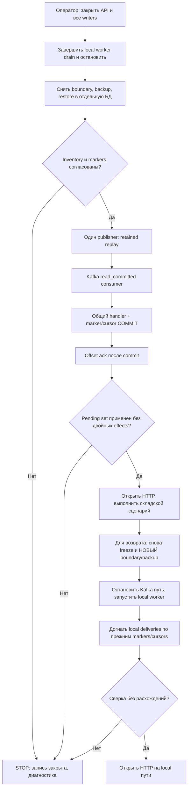

# Переключение local worker → Kafka и возврат

Владелец подробного WMS-506 flow. Решение — [ADR-0038](../adr/0038-dev-transport-cutover.md).
Реализована автоматическая репетиция на disposable dev-данных. Рабочий стенд этим
изменением не переключается. Оператор выполняет отдельную разрешённую операцию
по этому runbook после выбора конкретного окружения.

## Кто запускает и что проверяется

Пользователь задаёт WMS-506.1–6. Агент оформляет [source task](../tasks/wms-506.json),
готовит реализацию и review. Разработчик запускает из корня:

```sh
pnpm cutover:drill
pnpm harness:plan docs/tasks/wms-506.json
pnpm harness:run docs/tasks/wms-506.json
pnpm harness:ready docs/tasks/wms-506.json
```

`cutover:drill` вызывает backend `test:cutover`, затем существующий `test:prepare`
(contracts/build/OpenAPI/compiled tests) и только `kafka-cutover.spec` в одном Jest
process. Команда создаёт PostgreSQL с migrations0034 и Kafka с mTLS, не использует рабочую
DATABASE_URL и не подключается к рабочим volumes. Нужны Node/pnpm по root package.json,
Docker и OpenSSL. Другой test:prepare/check:pr/dev compiler одновременно не запускают.

Успех требует двух tests: полного переключения в обе стороны и отказа при активном
claim. Exit0 подтверждает эти проверки. Он не заменяет полный PR gate или приёмку
пользователя. Harness привязывает результаты к содержимому текущих файлов; процесс
и полномочия описаны [отдельно](engineering-harness.md).

Репетиция использует `worker-process.fixture` с настоящими WorkerModule,
ReceivingPostedHandler, InventoryService и production lifecycle. IPC снимает только
test barrier; порт0 исключает конфликт с dev worker9100. PublisherService,
PublisherRepository, KafkaEventTransport и KafkaApplicationConsumer работают
на настоящих PostgreSQL/Kafka. Отдельные publisher/consumer executable entrypoints,
lost ack, crash после DB commit и rebalance проверяются также suites WMS-503/504/505
в полном check:pr. В этой репетиции они не подменены вызовом складской логики из теста.

## Участники, доверие и результат

Оператор управляет только выбранными локальными процессами и disposable контейнерами.
Он имеет DB admin доступ для backup/restore; UUID оператора сам таких прав не даёт.
Клиент HTTP использует настоящую server session, warehouse role, Origin/CSRF и
Idempotency-Key. EventId/envelope создаёт прежний writer. Kafka boundary остаётся
недоверенным и проходит schema/routing/retained validation перед handler.

Boundary содержит только техническую и складскую metadata. Envelope/session/raw
quarantine в нём отсутствуют. Backup содержит полную БД и является приватным.
Encryption keys quarantine хранят отдельно; backup ciphertext без ключей не даёт
восстановить raw. В Git/логи backup и ключи не помещают.



## 1. Подготовка и закрытие записи

1. Зафиксировать revision/image digest, версии PostgreSQL/Kafka/SDK, конфигурацию
   topics/partitions/key hash, stable consumer/group `inventory.putaway`, время и оператора.
   Совместимые schemas проверить `pnpm registry:check` на том же Git artifact.
2. Проверить объём диска и retention. Сохранить список API/CLI/import writers и всех
   worker/publisher/consumer процессов, включая старые pods/nodes. Один replicas1
   не доказывает отсутствие старого процесса. Не снимать singleton lock вручную.
3. Остановить входящие HTTP writers и дождаться bounded API drain. Остановить также
   seed/bootstrap/recovery/import команды. Прятать кнопки UI недостаточно.
4. Дождаться выбранного local boundary и завершить local worker через SIGTERM.
   Он прекращает новые claims и завершает уже начатый callback в заданный timeout.
   Подтвердить фактический exit процесса и отсутствие processing/lease в БД.
   Если claim остался после crash, восстановить его прежним worker protocol, затем
   снова остановить worker. Не очищать tokens вручную.
5. Остановить предварительно запущенные publisher/consumers, если они есть. Снять
   два одинаковых DB snapshots после drain и проверить, что HTTP listener закрыт.
   Автоматический drill доказывает freeze отказом нового HTTP соединения; других
   writers в его disposable окружении нет.

## 2. Snapshot и backup

SQL [transport-boundary.sql](../examples/transport-boundary.sql) выполняет один
read-only SELECT. Возвращает все retained event identities, markers/cursors каждого
существующего consumer, transport cursors/deliveries, pending receipt set и inventory
fingerprints. Версии — decimal strings. Checks проверяют retained prefix, consumer
prefix markers, completed без marker, leases, dead/quarantine, reserve/allocations
и physical ledger. Ненулевое значение любого check означает STOP.

Для выбранного локального PG контейнера пример ниже требует явно заполненных
`WMS_CUTOVER_PG`, `WMS_CUTOVER_DB_USER`, `WMS_CUTOVER_DB`. Эти значения идентифицируют
контейнер и БД, не содержат пароль. Пароль не передают аргументом процесса.

```sh
umask 077
WMS_CUTOVER_EVIDENCE=$(mktemp -d)
docker exec -i "$WMS_CUTOVER_PG" psql -X -v ON_ERROR_STOP=1 \
  -U "$WMS_CUTOVER_DB_USER" -d "$WMS_CUTOVER_DB" -At \
  < docs/examples/transport-boundary.sql > "$WMS_CUTOVER_EVIDENCE/boundary.json"
jq -e '.checks | all(. == 0)' "$WMS_CUTOVER_EVIDENCE/boundary.json"
docker exec "$WMS_CUTOVER_PG" pg_dump -U "$WMS_CUTOVER_DB_USER" \
  -d "$WMS_CUTOVER_DB" -Fc > "$WMS_CUTOVER_EVIDENCE/database.dump"
shasum -a 256 "$WMS_CUTOVER_EVIDENCE/database.dump"
```

Запускать по шагам с проверкой exit status, не продолжать после ошибки. Restore
выполнять только в новую отдельно названную БД. В автоматическом drill имя
`restore_<uuid>`, archive `/tmp/restore_<uuid>.dump` внутри disposable контейнера:
`createdb`, `pg_restore --exit-on-error`, затем повтор ТОГО ЖЕ SQL и полное сравнение.
Source database не очищается и не перезаписывается. Архив удаляется после сверки;
в evidence остаются SHA256/bytes и snapshots. Restore в другой server потребует
отдельного плана PostgreSQL roles/grants/globals, расширений и encryption keys.

Снять broker lows/highs по partition и committed offsets группы, пока все publisher/
consumers остановлены. В Strimzi client pod с настроенным mTLS `/tmp/consumer.properties`
(создаётся по [platform gate](../../scripts/kafka-gate.cjs), не содержит credentials в Git):

```sh
/opt/kafka/bin/kafka-get-offsets.sh --bootstrap-server "$WMS_CUTOVER_BOOTSTRAP" \
  --command-config /tmp/consumer.properties --topic warehouse.receiving.events --time earliest
/opt/kafka/bin/kafka-get-offsets.sh --bootstrap-server "$WMS_CUTOVER_BOOTSTRAP" \
  --command-config /tmp/consumer.properties --topic warehouse.receiving.events --time latest
/opt/kafka/bin/kafka-consumer-groups.sh --bootstrap-server "$WMS_CUTOVER_BOOTSTRAP" \
  --command-config /tmp/consumer.properties --describe --group inventory.putaway
```

Consumer ACL может не позволять group describe. Тогда использовать отдельно разрешённого
локального администратора; не расширять runtime ACL ради диагностики. В test fixture
broker admin fetchTopicOffsets/fetchOffsets сохраняет эти значения как строки.
Offsets и aggregateVersion не сопоставляются арифметически. Snapshot БД и broker
не атомарны; их согласованность зависит от доказанной остановки writers.

## 3. Перенос pending обязанностей и запуск Kafka

Составить для каждого logical consumer pending set: retained eventId без marker
в границах соответствующего aggregate stream. В текущем приложении только receipt
подписан `inventory.putaway`. Другие facts публикуются в свои topics без нового
consumer. Не создавать подписку по одному только наличию topic.

Сохранить local deliveries без изменения destination/status/attempts. Existing
consumer cursor продолжает local N; новый receipt без истории начинает с0. Проверка
N+1 использует существующий protocol test WMS-504.6 с technical handler, поскольку
реальный domain сейчас публикует один receipt-posted факт на документ. Репетиция
WMS-506 проверяет настоящие receipt/task effects, не выдумывает второе posting.

При закрытом HTTP запустить consumer и одного publisher с существующими opt-in/mTLS
параметрами: [consumer startup](kafka-consumer.md), [publisher startup](publisher.md).
Root entrypoints — `pnpm consumer` и `pnpm publisher`; последний выполняет Registry
preflight. Существующий Kafka offset сохраняется. При отсутствующем offset runtime
читает с beginning и проверяет retained identity/DB cursor. Если нужная broker history
уже удалена, не открывать запись и не выводить cursor из первого доступного сообщения.

Publisher использует полный retained replay. Старые факты могут попасть в Kafka вновь,
но только pending set получает новый application effect. Не называть это публикацией
только pending records. Это выбранный безопасный режим ADR-0034, без ручного skip-prefix.

Дождаться completion всех retained publisher deliveries и применения pending set.
`tick=idle` недостаточно: retry может ждать available_at. Проверить отсутствие dead,
quarantine, новых gaps, сохранность markers и unchanged stock/movements при создании
только tasks. Local pending backlog в Kafka-режиме сохраняется намеренно; application
backlog измеряется по отсутствующим markers/Kafka metrics, а не по локальному ack.

## 4. Открытие и проверка бизнес-флоу

Открыть API после успешной сверки, затем выполнить:

1. HTTP receipt create/post с replay того же Idempotency-Key.
2. Kafka delivery создаёт ровно одну task без повторного stock credit.
3. Полное putaway receiving→storage, order confirm/reserve, pick6 из10.
4. Ship4, cancel оставшихся6, физический возврат staged2 в storage.
5. Получить `closed_mixed`, shipped4/cancelled6, reserved0; сверить ledger и allocations.

Повтор того же Kafka eventId должен подтвердить offset без новых task/movement/marker.
Drill ждёт broker commit offset за реально отправленной duplicate позицией, а не
принимает отсутствие нового эффекта за доказательство обработки сообщения.

Для outage drill останавливает consumer, делает Docker pause только своего broker,
проводит новую HTTP приёмку, затем пробует publish. Receipt/stock/outbox commit успешен,
task ещё не создана, delivery становится retry без completion. После unpause создаются
новые publisher/consumer owners, прежний eventId применяется один раз. Это network
outage, не тест HA single-broker. Lost ack/crash/rebalance дополняются suites503/504/505.

## 5. Возврат после новых эффектов

Снова закрыть HTTP/все writers. Завершить consumer и publisher, дождаться их exit и
освобождения singleton. Снять НОВЫЕ boundary, broker offsets и backup; проверить restore.
Если осталась unresolved quarantine/gap/uncertain effect — STOP, возврат не является
разрешением обойти ошибку.

Запустить прежний local worker с тем же `inventory.putaway`. Для Kafka-применённых
events marker исключает повтор effects; worker продвигает собственный transport cursor
по порядку и завершает local deliveries. Для новых неприменённых событий выполняет
настоящий handler. Не менять consumer cursor, eventId, attempts и историю вручную.

После drain localPending/pendingEffects должны быть пустыми, local cursor равен
consumer cursor каждого receipt stream. Сохранённые markers остаются, inventory и
movements не меняются от replay; добавляются только ожидаемые новые tasks/markers.
Только после этих проверок открыть API. Автоматическая репетиция оставляет новую
pending приёмку перед reverse и проверяет одновременно replay и новый эффект.

Старый backup не restore-ится поверх новых фактов. Disaster restore после потери БД
и повторная доставка внешних effects требуют отдельного recovery плана. Outbox и
application business audit остаются в БД, Kafka не становится source of truth.

## Stop criteria, evidence и ограничения

STOP при недоступной/непроверенной backup, любом ненулевом checks, изменении snapshot
при freeze, неизвестном writer/старом singleton, retention gap, dead/quarantine,
невозможности mTLS/ACL/schema validation, расхождении pending set и эффекта.
Не открывать запись после timeout «потому что pods Running». Исправить причину по
владельцу recovery, снять новую границу и повторить проверку. Нельзя компенсировать
gap сбросом cursor/offset, удалением quarantine или переименованием consumer.

Drill сохраняет private `artifacts/cutover/<uuid>.json`: timestamps, Node version,
backup hashes/bytes, forward/drained/outage/reverse/returned snapshots и broker offsets.
UUID artifact не является командой на рабочий стенд. Эти observations не заменяют
успешный exit Jest/harness. Все tests создают свои resources, закрывают consumer до
DB graph и удаляют только собственные containers/restore DB/archive в finally.

Проверено только локальное isolated окружение. Не проверены production deployment,
restore на новый PG server, partition expansion, смена key/group, потеря retained
истории, несколько publisher replicas и HA. Production storage/backup/key management
и операции внешнего deployment требуют отдельного согласованного окружения.
