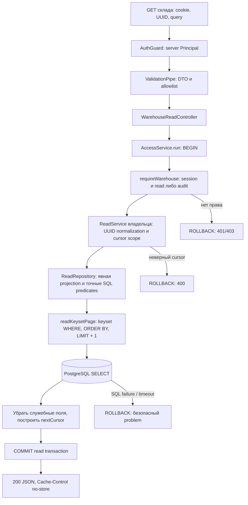
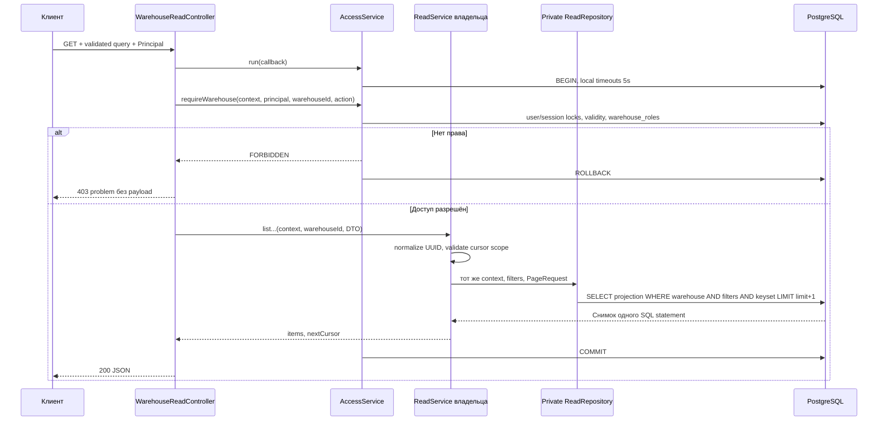

# WMS-207: чтение склада и история

## Для менеджера

Пользователь читает данные одного указанного склада. Остатки, документы, задания и
движения требуют право `read`. Аудит требует `audit`: его имеют order_manager и
warehouse_supervisor по ADR-0019. Системный администратор без складской роли доступа
не получает. Приложение не выдаёт общий список данных всех складов.

`onHand` — физическое учётное количество. `reserved` — сумма активных allocations.
`available = onHand - reserved` — свободное учётное количество. Это не разрешение
резервировать товар в любой зоне. Резервирование разрешено только в `storage`.
Ответ остатков содержит `locationKind`, чтобы клиент различал зоны.

Списки документов и заданий возвращают краткие DTO. Полный документ и его строки
остаются в существующих GET detail API. История движений показывает количество и
основание. Аудит показывает действие, субъекта, объект, время, причину и correlationId.
Произвольный JSON `changes`, пароли, токены и внутренние ORM-модели не выдаются.

## Маршруты и фильтры

Общий префикс: `GET /api/v1/warehouses/:warehouseId/`. WarehouseId — UUID.
Все маршруты принимают `limit` и `cursor`. Фильтры соединяются через AND.

| Суффикс         | Дополнительные точные фильтры        | Порядок                  |
| --------------- | ------------------------------------ | ------------------------ |
| `balances`      | productId, locationId, locationKind  | id ASC                   |
| `movements`     | productId, locationId, kind, auditId | createdAt DESC, id DESC  |
| `receipts`      | status, receivingLocationId          | createdAt DESC, id DESC  |
| `orders`        | status                               | id ASC                   |
| `putaway-tasks` | productId, status, sourceReceiptId   | createdAt DESC, id DESC  |
| `picking-tasks` | status, orderId, assigneeId          | createdAt DESC, id DESC  |
| `shipments`     | status, orderId                      | createdAt DESC, id DESC  |
| `audit`         | entityType, entityId, correlationId  | occurredAt DESC, id DESC |

UUID фильтры нормализуются в lowercase. Status/kind/entityType имеют закрытые enum,
описанные в [OpenAPI](../contracts/openapi.json). Свободный поиск, OR, массивы,
произвольный sort, offset, count/total и фильтры по JSON отсутствуют. Неизвестный или
повторный параметр, неверный UUID/enum, limit вне 1..100 и неверный cursor дают
400 VALIDATION_FAILED. Default limit — 20. Выборка берёт максимум limit+1 строк.

### Пример

```http
GET /api/v1/warehouses/00000000-0000-4000-8000-000000000001/balances?locationKind=storage&limit=20
Cookie: wms_session=<локальная тестовая сессия>
```

Синтетический JSON, без реального токена:

```json
{
  "items": [
    {
      "id": "00000000-0000-4000-8000-000000000002",
      "warehouseId": "00000000-0000-4000-8000-000000000001",
      "productId": "00000000-0000-4000-8000-000000000003",
      "locationId": "00000000-0000-4000-8000-000000000004",
      "locationKind": "storage",
      "onHand": 10,
      "reserved": 6,
      "available": 4
    }
  ],
  "nextCursor": null
}
```

Если nextCursor не null, клиент передаёт его в следующий GET с теми же фильтрами.
При смене фильтров клиент начинает список заново. Limit можно менять между страницами.
При завершении списка возвращается nextCursor=null; пустой результат — items=[] и null.

## Движение данных



1. API middleware назначает correlationId и no-store. AuthGuard проверяет настоящую
   сессию. GET не требует Idempotency-Key или CSRF-команду.
2. DTO pipe проверяет query и path. Склад из URL не считается доказательством доступа.
3. Controller открывает один bounded run через AccessService. Внутри повторно
   проверяются session/user и право на склад. User/session locks удерживаются до commit.
   Административная смена роли пользователя ждёт этот user lock.
4. Controller вызывает экспортируемый ReadService владельца. Service нормализует
   UUID и связывает cursor с ресурсом, складом и всеми указанными фильтрами.
5. Private repository перечисляет JSON-поля и добавляет warehouse predicate. Только
   фиксированные SQL identifiers находятся в коде; значения передаются параметрами.
6. Общий PostgreSQL adapter выполняет один SELECT. Доступность вычисляется в той же
   строке, что onHand и reserved. Служебные ключи не попадают в JSON.
7. Callback возвращает страницу. Runner коммитит read transaction до HTTP-ответа.
   Ошибка policy/cursor/SQL откатывает run; partial page клиент не получает.



### Границы компонентов

API adapter находится в infrastructure/http и регистрируется только AppModule.
Это composition нескольких владельцев чтения, а не новый домен или repository всех
таблиц. Inventory/Receiving/Fulfillment/Audit экспортируют ReadService; repositories
остаются private. Worker не импортирует этот controller или Identity graph.
Общий cursor protocol находится в shared/pagination и не зависит от Nest/ORM.
Общий SQL keyset adapter находится в infrastructure/database.

Read DTO модуля содержат HTTP-декораторы, как существующие DTO. Это допустимая
зависимость внутри backend; публичный контракт — OpenAPI JSON, а не импорт классов
другим приложением. Новых очередей, процессов и read-model таблиц нет.

## Защита истории аудита

AuditReadRepository выводит склад через retained связи объектов: warehouse,
location, stock-balance, receipt, putaway-task, order, picking-task, shipment и allocation.
Для picking/shipment используется родительский order, для allocation — balance.
Это ограниченные read-only JOIN/EXISTS для полиморфной ссылки аудита; запись в чужие
таблицы и вызов чужого repository не выполняются.

Нельзя заменить scope на `changes.warehouseId` или один correlationId. JSON изменений
не является доказательством принадлежности. Даже при совпадающем entityId/correlationId
warehouse predicate остаётся обязательным. Глобальные identity/catalog/outbox-admin
записи не включены в складской audit view. Будущий новый entityType требует явного
scope mapping и теста на чужой склад. Формат ограниченной выдачи не меняет retained
write schema и не обещает защиту от DBA.

## Cursor и согласованность

Cursor v1 — bounded base64url JSON с fingerprint ресурса/фильтров и последним ключом.
Он не секрет, не подпись и не capability доступа. Клиент может изменить позицию,
но не обойти повторную ACL и SQL scope. Срок хранения серверного cursor state отсутствует.

Для временных списков WHERE использует `(timestamp,id) < (:time,:id)` и DESC обоих
полей. Время формируется SQL to_char в UTC с шестью дробными знаками. JS Date не
используется для переноса ключа: округление до миллисекунд пропускает строки одной
микросекунды. UUID разрешает равные timestamps. Неканоническое время, невозможная
дата и год 0000 отклоняются до SQL. Для stock/orders нет createdAt; UUID ASC даёт
стабильную навигацию и не означает порядок создания.

Каждая страница — текущий statement snapshot READ COMMITTED. Серия страниц не
фиксирует один снимок БД. При изменении status/фильтра между запросами строка может
войти в выборку или выйти из неё. Новый факт с ключом до уже пройденной границы
потребует обновить список с первой страницы. Timestamp начала транзакции не даёт
commit order. Snapshot export и отчёт на фиксированный момент здесь не реализованы.

Балансы, available, движения, orders, picking и shipments читаются синхронно после
commit их команд. PutawayTask создаётся асинхронным worker: после posting приёмка и
stock уже видны, а списка задания может ещё не быть. Когда worker commit выполнен,
read API видит задание из той же основной БД. Новый eventual-consistent projection
этот этап не вводит; существующее ожидание worker не маскируется как потеря данных.

## Индексы и ограничения запросов

Новая migration 0032 добавляет B-tree: warehouse/id для stock/orders;
warehouse/createdAt/id для receipt/putaway/movement; дополнительные product keys
для stock/movement; orderId/createdAt/id для picking/shipment; occurredAt/id и
entityType/entityId/occurredAt/id для аудита. Предыдущие индексы и applied SQL сохранены.
Обратный B-tree scan поддерживает DESC. Нет требования заставлять PostgreSQL
выбирать индекс вместо корректного Seq Scan на небольшой таблице.

Read run наследует statement_timeout и transaction_timeout 5s от identity runner.
Лимит строк ограничивает ответ, но не гарантирует постоянную стоимость всех filters.
Audit scope может проверить несколько retained таблиц. Списки picking/shipment по
складу соединяются с orders и могут сортировать результат. Перед ростом нагрузки
нужно повторить EXPLAIN на реальном распределении, а не обещать масштабирование
по результату локального набора. Текущий этап не добавляет denormalized warehouse_id.

## Проверки веток

| Ветка                                                                  | Постоянный тест                                       |
| ---------------------------------------------------------------------- | ----------------------------------------------------- |
| DTO, остаток/доступность, exact filters, audit scope                   | warehouse-reads.spec.ts                               |
| Равные timestamps, полный обход страниц и точность microseconds        | warehouse-reads.spec.ts; warehouse-read-plans.spec.ts |
| malformed/cross-filter/cross-resource cursor, limit                    | keyset-page.spec.ts; warehouse-reads.spec.ts          |
| Чужой склад, admin без роли, viewer без audit, revoke между страницами | warehouse-reads.spec.ts                               |
| Все девять типов audit entity: свой и чужой склад при доступе к обоим  | warehouse-reads.spec.ts                               |
| Пустая выдача, unknown/repeated filters, SQL-like input                | warehouse-reads.spec.ts                               |
| Отказы существующих detail routes                                      | warehouse-reads.spec.ts                               |
| EXPLAIN восьми реальных production SQL и массовая пагинация            | warehouse-read-plans.spec.ts                          |

[Результаты, review и команды](../reports/wms-207.md). Все тесты — синтетические;
PostgreSQL работает в disposable Testcontainers, dev volume не меняется.
