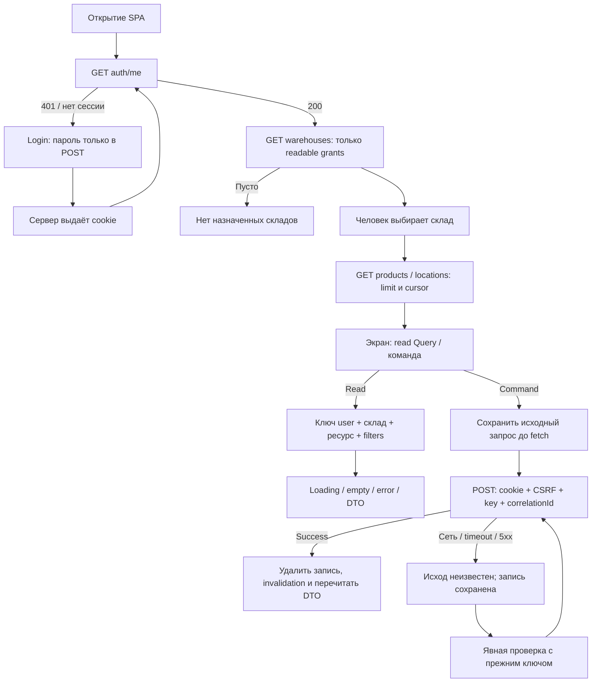
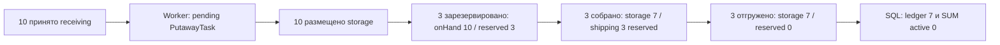

# WMS-208: движение данных через пользовательский интерфейс

Реализованный локальный SPA flow. [Web README](../../apps/web/README.md) описывает
запуск и файлы; [отчёт](../reports/wms-208.md) связывает требования с проверками.
Сервер остаётся владельцем бизнес-правил, auth, транзакций и складского учёта.

## Участники и доверие

Пользователь вводит DTO в форме. Вход, URL, sessionStorage и выбранный склад
недоверенные. Native input limits помогают исправить ввод; сервер повторно проверяет
DTO, session, warehouse ACL и состояние объекта. UUID пользователя и роль не берутся
из формы. Cookie HttpOnly устанавливает сервер. Профиль и CSRF живут только в памяти.



## Сессия, справочники и чтение

1. main.tsx создаёт QueryClient и providers, Router выбирает экран. SessionProvider
   вызывает auth/me. Login отправляет custom CSRF-protection header; складские POST
   используют session-bound CSRF. Пароль не попадает в query keys или журнал.
2. DirectoryReadController.listWarehouses открывает AccessService.run. SessionsService
   повторно проверяет сессию под user/session locks. AccessService читает роли, оставляет
   разрешённые read склады. WarehousesService нормализует cursor scope и передаёт IDs
   private repository. SQL выбирает `id/code/name WHERE id IN (...) ORDER BY id ASC LIMIT n+1`.
   Пустые grants дают пустую страницу. Commit read-транзакции освобождает locks.
3. После выбора склада products/locations проходят requireWarehouse в том же read
   context до SQL. CatalogRepository выбирает общий каталог организации. Locations SQL
   дополнительно содержит warehouse_id. DTO не содержат ORM, login или credentials.
   Справочники показывают отдельное сообщение загрузки. Успешная пустая страница
   показывает отсутствие товаров/ячеек и направляет к администратору. Ошибка не
   маскируется пустым select. Эти ветки проверены controlled response barrier в workspace tests.

4. useWarehouseList хранит отдельный InfiniteQuery по user/warehouse/resource/filters.
   Следующая страница передаёт cursor ровно от предыдущего ответа. Кнопка догружает
   данные; limit=100, сервер ограничивает 1..100. Неизвестные query поля отклоняются.
5. Keyed WorkspaceProvider пересоздаётся при смене склада. Выбранные документы и формы
   сбрасываются. Старые запросы получают AbortSignal. Ошибка скрывает старые строки;
   totals остатков показывают «—», пока нет корректного результата. Итоги относятся к
   загруженным строкам, а не ко всему складу при наличии следующей страницы.
6. Детали имеют user/warehouse/id в ключе. Сервер определяет склад самого объекта и
   проверяет доступ. Logout/401 очищают пользователя и весь private Query cache;
   cancelQueries прерывает read, затем clear удаляет данные. Новая сессия читает их заново.

401 возвращает к входу. 403 показывает понятное сообщение и не выдаёт чужие данные.
problem parser берёт только code/correlationId; raw detail/SQL/stack не выводятся.
Сетевой сбой GET/login получает отдельное сообщение NETWORK_ERROR: эти запросы не
создают журнал, поэтому UI не предлагает искать сохранённый command key.
Каталог глобальный только в текущей модели одной организации. Утрата права не даёт
серверу возможности стереть уже увиденные человеком данные. На новом read действует ACL.

Evidence: directory-reads.spec.ts (гранты, чужой склад, scope cursor, лимиты),
workspace.test.tsx (смена склада, error и формы), components.test.tsx (states/cache),
transport.test.ts (cookie/CSRF/401/timeout).

## Команда, commit и повтор

```mermaid
sequenceDiagram
  actor U as Сотрудник
  participant F as Форма / Workspace
  participant J as CommandJournal / sessionStorage
  participant A as ApiClient / proxy
  participant B as Nest controller / HttpCommandsService
  participant O as Owner services / PostgreSQL
  U->>F: Подтвердить DTO
  F->>J: execute(user, warehouse, URL, body)
  J->>J: UUID key + correlationId; запись ДО fetch
  Note over F,J: Single flight; fieldset disabled до завершения refresh
  J->>A: POST cookie + текущий CSRF + прежний body/key
  A->>B: DTO, Principal и CommandScope
  B->>O: BEGIN; auth/ACL до idempotency lookup
  alt Saved response уже существует
    O-->>B: Исходный saved result без нового эффекта
  else Первый запуск
    B->>O: Owner SQL, balances/movements/audit/outbox/result
    alt Любая ошибка
      O-->>B: ROLLBACK всех изменений
    else Успех
      O-->>B: COMMIT общей транзакции
    end
  end
  B-->>A: DTO либо problem
  alt Получен success
    A-->>J: Сохранённый результат
    J->>J: Удалить pending
    J-->>F: Success
    F->>A: Invalidate read cache, перечитать DTO
    F-->>U: Итоговый status и notice
  else Ответ потерян / timeout / 5xx
    A-->>J: UncertainResult
    J-->>F: Pending сохранён
    F-->>U: Требуется явная проверка
  end
```

CommandJournal принимает только известные складские URL. Auth/admin credentials не
проходят через журнал. Данные storage проходят runtime validation перед отправкой:
UUID, версия, userId, URL allowlist, JSON object, размер ≤262144 UTF-8 bytes.
SessionProvider передаёт ленивый accessor sessionStorage: browser getter вызывается
внутри обработки ошибок журнала. Его SecurityError не ломает login и чтение.
Ошибка получения или записи storage останавливает отправку команды с COMMAND_SAVE_FAILED.
Credentials/CSRF в storage запрещены.
Параметры форм не подменяют сохранённый body при повторе.

После успеха Workspace ждёт invalidation до снятия busy. Это не позволяет refetch
заменить введённое пользователем количество в уже открытой форме следующей команды.
Успешное создание draft блокирует повторное создание до кнопки «Новый черновик».
Новый черновик — новое явное намерение, поэтому получает новый key.
При неизвестном create форма также блокируется. После reload начальное состояние
восстанавливается из сохранённого create URL и warehouse. Успешный replay не снимает
эту блокировку: для следующего документа по-прежнему нужна кнопка «Новый черновик».

```mermaid
stateDiagram-v2
  [*] --> Ready
  Ready --> Saved: storage write успешно
  Ready --> Ready: storage error, HTTP не отправлен
  Saved --> InFlight: первая отправка
  InFlight --> Ready: success; удалить pending
  InFlight --> Ready: первый явный 4xx кроме 401/408
  InFlight --> Unknown: timeout / сеть / 401 / 408 / 5xx
  Unknown --> Unknown: reload той же вкладки
  Unknown --> InFlightReplay: явный повтор в исходном складе
  InFlightReplay --> Ready: success / saved result
  InFlightReplay --> Unknown: любой отказ или потеря ответа
```



Replay с 403/409 не доказывает rollback первой попытки: проверка прав/DTO предшествует
saved lookup. HTTP 408 и 5xx также не подтверждают rollback: журнал сохраняет
исходные URL/body/key и возвращает UncertainResult. Журнал сохраняет key и требует разбора. 401 требует login того же
пользователя и нового CSRF. Другая учётная запись не видит эту команду. Другой выбранный
склад блокирует recovery-кнопку, чтобы результат не относился к неверному workspace.
Если первая команда ещё не выполнилась, явный повтор может выполнить её сейчас.
После закрытия вкладки sessionStorage теряется; отдельного durable server status API
нет. Эти ограничения нельзя описывать как гарантированное восстановление после любого crash.

Evidence: journal.test.ts (single flight, неизменный запрос, timeout/reload, storage
failure, 4xx/replay), workspace.test.tsx (новый draft, refetch quantities), browser
gate (commit приёмки → потеря ответа → reload → same-key result, один документ).

## Экраны и изменение складского состояния

| Триггер UI                            | Вызов / результат сервера                                   | Промежуточное состояние и продолжение                                                       |
| ------------------------------------- | ----------------------------------------------------------- | ------------------------------------------------------------------------------------------- |
| Создать приёмку                       | POST receipts, ReceiptDto draft                             | Остаток не меняется; отдельное проведение                                                   |
| Провести                              | POST receipts/:id/post                                      | 10 в receiving; ReceivingPosted в outbox; task пока нет                                     |
| Worker обрабатывает событие           | ReceivingPostedHandler → inventory.createPutawayTasks       | Task pending, marker/cursors/delivery completed; stock не начисляется повторно              |
| Разместить                            | POST putaway-tasks/:id/execute                              | Receiving 0, storage 10; task completed; парные movements                                   |
| Подтвердить заказ                     | POST orders/:id/confirm                                     | Active; количество ещё не зарезервировано                                                   |
| Зарезервировать выбранные строки      | POST orders/:id/reserve                                     | Сервер выбирает storage; allocations + reserved; нехватка откатывает весь запрос            |
| Создать и принять сборку              | POST orders/:id/picking-tasks, POST picking-tasks/:id/start | План ready → in_progress, исполнитель — текущий пользователь                                |
| Зафиксировать фактическое             | POST picking-tasks/:id/confirm                              | Stock и reserve переносятся storage → shipping; partial/shortage сохраняет открытый остаток |
| Подготовить отгрузку                  | POST orders/:id/shipments, выбранные allocation/quantity    | Неизменяемый draft; частичность определяется составом документа                             |
| Подтвердить отгрузку                  | POST shipments/:id/post                                     | OnHand и reserved уменьшаются вместе с active allocation; движение отгрузки                 |
| Отменить draft shipment               | POST shipments/:id/cancel, reasonCode                       | Stock и reserve не списываются                                                              |
| Освободить часть резерва              | POST orders/:id/allocations/:allocationId/release           | Только разрешённый незапланированный storage reserve; причина и история                     |
| Отменить заказ                        | POST orders/:id/cancel; основание задаёт сервер             | Storage reserve освобождён; staged требует cancel_pending                                   |
| Подтвердить полный физический возврат | POST orders/:id/cancellation-return                         | Неотгруженное staged → storage, резерв освобождён, cancelled либо closed_mixed              |

Формы показывают только допустимые исходные статусы, но кнопки не являются policy.
API заново проверяет исполнителя, права и состояние под locks. Отказы показываются
как бизнес-ошибки, не выполняют клиентскую «компенсацию». Произвольных stock adjustments
и возврата уже отгруженного UI не добавляет. Подробности транзакций принадлежат
[приёмке](../receiving.md), [размещению](putaway-execution.md),
[резервированию](reservations.md), [сборке](picking.md), [отгрузке](shipping.md).

## Согласованность и gate 2

Все read DTO читают PostgreSQL синхронно после commit. Общего snapshot между страницами
нет. UI не меняет остаток оптимистически. Другой процесс может изменить данные после
отображения; серверная команда проверяет актуальное состояние. Putaway зависит от
отдельного worker, поэтому posted receipt не означает готовое задание. Есть явное
обновление страницы; постоянного фонового poll нет.



web-gate.spec.ts запускает disposable PostgreSQL с реальными migrations, API,
production worker graph, Vite proxy и Chromium. Пользовательские операции выполняет
браузер; только шаг worker запускается тестом для наблюдения промежуточного состояния.
Gate включает настоящий двойной клик под barrier ответа (один POST), потерю ответа
после commit, reload/same key, отмену shipment draft,
partial reserve/release, partial pick/ship и полный staged return. Дополнительный
partial-сценарий уменьшает итог с 7 до 6 одной новой отгрузкой. SQL сравнивает balances,
signed movements, reserved и active allocations. Viewer получает 403 при попытке
приёмки; чужой склад не появляется. Tab/Enter/skip link и labels проверены в Chromium.

Browser/Vite/harness закрываются в finally/afterAll с ограниченным ожиданием.
Недоступные Docker/Chromium приводят к failure, не к skip. Unit tests остаются в jsdom;
backend Jest coverage не включает web, Vitest coverage не включает Chromium.
Production static hosting/TLS/NGINX/Kubernetes, WCAG audit и другие браузеры — будущая
работа, не доказанный результат gate 2.
