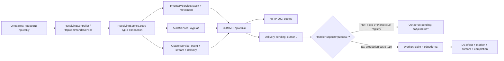
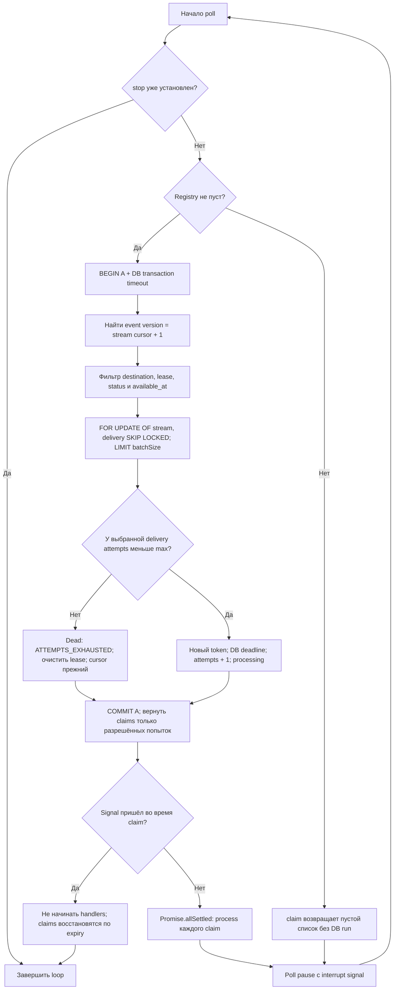
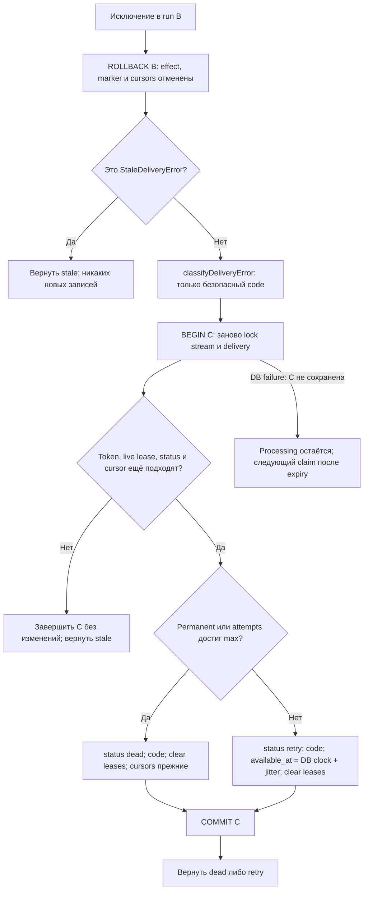
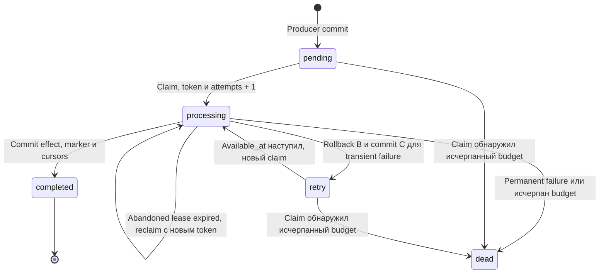
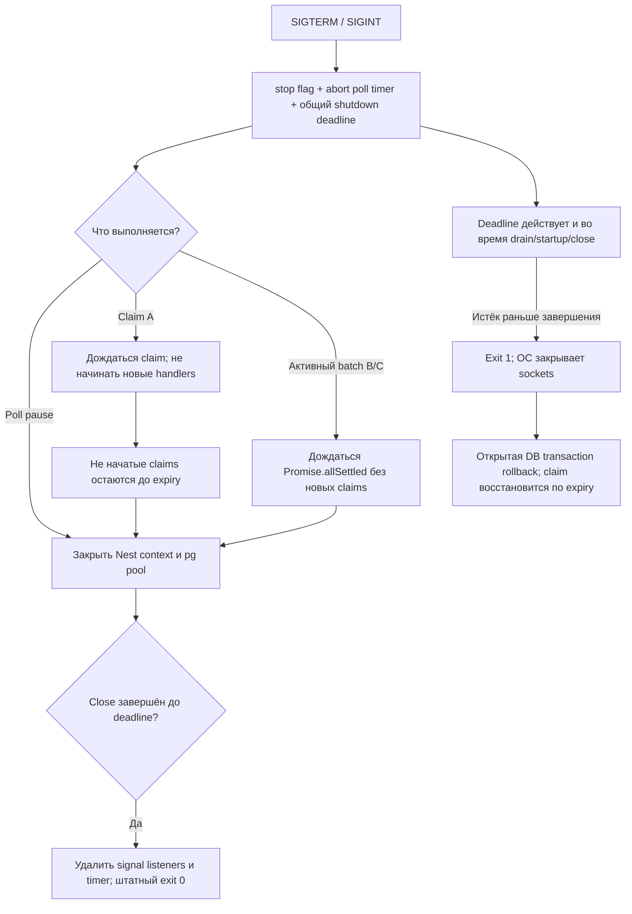

# Флоу PostgreSQL worker: от события до подтверждения

Подробный разбор WMS-109 для менеджера и разработчика. Схемы описывают текущий
код, а не целевую архитектуру Kafka. Имена методов позволяют перейти от шага к реализации.
[Контракт и настройки worker](../../apps/backend/src/infrastructure/worker/README.md),
[сценарий приёмки](../receiving.md), [общие гарантии outbox](../outbox.md).

## 1. Откуда берётся работа и что происходит сейчас

API уже завершил приёмку: receipt posted, stock/movement/audit/event и HTTP result
зафиксированы вместе. Worker работает с **сохранённым фактом**, stock приёмки не начисляет.
Документ можно считать принятым до появления последующего задания размещения.



WMS-110 регистрирует настоящий ReceivingPostedHandler: inventory.putaway создаёт
pending PutawayTask, не начисляя stock повторно. Подробная ветка бизнес-эффекта —
[putaway flow](putaway.md). Явно пустой registry используется только в protocol tests:
он не вызывает no-op и не подтверждает доставку. Technical DB handlers также остаются
только test fixtures; production использует публичный inventory API.

## 2. Три транзакции вместо одной длинной

| Граница | Владелец и методы | Что сохраняется | Когда освобождаются locks |
|---|---|---|---|
| A: claim | WorkerService.claim → WorkerRepository.claim | Processing, attempts, lease/token stream и delivery | После COMMIT A; handler ещё не выполнялся |
| B: обработка | WorkerService.process → lock/prepareConsumer → handler → markProcessed/complete | Effect, marker, consumer cursor, completed и delivery cursor | После COMMIT B или ROLLBACK B |
| C: отказ, только после ошибки B | WorkerService.process catch → lock/fail | Safe error code, retry deadline либо dead, освобождение scheduling lease | После COMMIT C или ROLLBACK C |

Транзакцию A нельзя держать открытой до завершения всего batch: это мешало бы другим
workers выбирать независимые потоки. Транзакцию B нельзя разрывать между effect и
marker/ack: иначе crash мог бы оставить эффект без доказательства его применения.
C начинается после rollback B и заново доказывает владение token; старый worker
не вправе менять новый claim. Во всех runs runner использует read committed.

## 3. Polling и выбор следующего события

[WorkerLoop.poll](../../apps/backend/src/infrastructure/worker/services/worker-loop.ts)
запускает один batch, ожидает все его результаты, затем делает poll pause. Разные
потоки batch обрабатываются параллельно, максимум batchSize=4 при pool=5.
Новый poll не создаётся поверх незавершённого предыдущего batch.



Диаграмма budget показывает обработку одной выбранной строки; код повторяет её для
каждого кандидата batch. Если подходящих строк нет, COMMIT A возвращает пустой список.
Ошибка claim даёт rollback A и безопасный poll log; после паузы loop попробует снова.
Ошибка сохранения результата одной доставки не отменяет результаты других потоков.

**Как проходит фильтр.** Сначала выбирается только event с версией cursor+1.
Destination должен иметь реальный handler. Stream lease должен быть свободен либо
истечь. Для pending/retry дополнительно нужен available_at не позже DB clock;
для processing — истёкший delivery lease. Занятые row locks пропускаются. Dead
вообще не кандидат, а следующая версия не совпадёт с cursor+1 — поток остановлен.

Например, у receipt A существуют v1 и v2, cursor=0. Взять можно только v1.
Если v1 retry до 12:00:10, в 12:00:05 нельзя взять ни v1, ни v2. Worker продолжит
работу с receipt B, если его next event доступен. После успешного v1 cursor=1,
и следующий poll сможет выбрать v2.

## 4. Успешная обработка и ветка дубликата

Claim — immutable scalar DTO: eventId, destination, aggregateType, aggregateId,
version, token. Payload загружается из БД заново под locks, а не доверяется caller.
[WorkerService.process](../../apps/backend/src/infrastructure/worker/services/worker.service.ts)
владеет run B, [WorkerRepository](../../apps/backend/src/infrastructure/worker/repositories/worker.repository.ts)
выполняет SQL, зарегистрированный handler получает тот же TransactionContext.

```mermaid
sequenceDiagram
  participant L as WorkerLoop
  participant S as WorkerService
  participant R as WorkerRepository
  participant DB as PostgreSQL
  participant V as EventContracts
  participant H as Registered DB handler
  L->>S: process(claim)
  S->>DB: BEGIN B + whole-transaction timeout
  S->>R: lock(context, claim)
  R->>DB: FOR UPDATE stream + delivery
  DB-->>R: Текущее состояние после ожидания locks
  R-->>S: Live token/status/cursor либо null
  alt Claim stale / expired / completed
    S->>DB: ROLLBACK B
    S-->>L: stale, без failure run C
  else Claim принадлежит этому worker
    S->>V: parseForHandler(JSON envelope)
    V-->>S: KnownEvent
    S->>S: Сверить routing identity и найти handler
    S->>R: prepareConsumer(context, claim)
    R->>DB: Создать и lock consumer cursor; прочитать marker
    alt Marker отсутствует и consumer cursor = version - 1
      S->>H: handle(context, event)
      H->>DB: Awaited эффект через сервисы владельцев
      H-->>S: Callback завершён; это ещё не commit
      S->>R: markProcessed(context, claim)
      R->>DB: INSERT processed_events
    else Marker есть и consumer cursor не меньше version
      Note over S,H: Handler пропускается, эффект не повторяется
    end
    S->>R: complete(context, claim)
    R->>DB: Consumer cursor, completed delivery, delivery cursor, clear leases
    S->>DB: COMMIT B
    S-->>L: completed
  end
```

Таблица ниже показывает одну delivery v1 и первый эффект. Значения внутри B другие
transactions ещё не видят. Consumer cursor может ещё не иметь строки — это отмечено «нет».

| Момент | Delivery | Attempts | Token | Delivery cursor | Consumer cursor | Marker | Подтверждённый effect |
|---|---|---|---|---|---|---|---|
| До claim | pending | 0 | null | 0 | нет | нет | нет |
| После COMMIT A | processing | 1 | T1 | 0 | нет | нет | нет |
| После handler, но до COMMIT B | Для других всё ещё processing | 1 | T1 | 0 | нет | нет | нет |
| После COMMIT B | completed | 1 | null | 1 | 1 | есть | есть |
| Если B откатилась | processing до решения C/reclaim | 1 | T1 | 0 | нет | нет | нет |

При уже существующем marker consumer cursor не уменьшается: complete использует
GREATEST. Так transport cursor может догнать ранее обработанную историю без повторного
эффекта. Это проверяется controlled test replay; публичного replay CLI сейчас нет.
Marker без достаточного consumer cursor или gap без marker приводит к CURSOR_MISMATCH,
rollback B и permanent error flow, а не к успешному пропуску версии.

## 5. Ошибка, rollback, retry и dead



Permanent: отказ контракта, явный PermanentDeliveryError и SQLSTATE классов 22/23/42.
Остальные ошибки transient, но budget конечен. В last_error сохраняется allowlisted
код, не raw exception.message. Ошибка C может возникнуть и на lock, и на записи, и при
commit; схема показывает общий выход без подтверждённого failure result.

С default base=1000ms и max=60000ms первая retry задержка 500..1000ms, вторая
1000..2000ms; после достижения cap задержка 30000..60000ms. available_at считает
PostgreSQL. При десятом неуспешном claim/обработке с default maxAttempts=10 доставка
может перейти в dead; новый claim после crash также проверяет исчерпанный budget.



Истечение lease само не меняет статус: нужен следующий claim. Переход в dead на
claim актуален также после уменьшения maxAttempts в конфигурации. Из dead текущий
worker не делает переходов, а completed не сбрасывается в pending автоматически.
Управляемые retry/replay CLI — будущий этап WMS-111.

**Неизвестный исход commit.** Если B успела committed, а worker потерял подтверждение,
повторная проверка в C увидит completed/снятый token и ничего не перепишет. Новый poll
не выберет completed событие. Если B действительно откатилась, marker/effect отсутствуют,
и текущий владелец сможет назначить retry либо другой worker восстановит expired claim.

## 6. Два workers, expiry и stale token

```mermaid
sequenceDiagram
  participant A as Worker A
  participant DB as PostgreSQL
  participant B as Worker B
  A->>DB: COMMIT claim v1, token T1
  alt A уже держит processing locks в B transaction
    A->>DB: Lock stream/delivery, начать handler
    Note over A,DB: Lease может истечь, row locks ещё удерживаются
    B->>DB: Claim через SKIP LOCKED
    DB-->>B: Этот поток пропущен; доступны другие агрегаты
    A->>DB: COMMIT effect + marker + cursors + completion
  else A умер после claim, открытой processing transaction нет
    Note over A,DB: Дождаться DB lease expiry
    B->>DB: Reclaim v1 после expiry
    DB-->>B: Новый token T2, attempts + 1
    A->>DB: Поздняя попытка process с T1
    DB-->>A: Token не совпадает: stale, эффекта нет
    B->>DB: Lock и проверить T2; effect + marker + completion
    B->>DB: COMMIT
  end
```

Во второй ветке поздняя попытка A означает возобновление задержанного процесса либо
повтор его старого сообщения; умерший процесс сам не оживает. Новый token выдаётся
только при budget attempts < maxAttempts, иначе claim паркует delivery в dead.
Lease — право начать обработку, locks — защита активной DB transaction. Этот протокол
не отменяет уже начатую сетевую отправку и не является fencing для Kafka publisher.

## 7. SIGTERM: остановка poll, drain и закрытие ресурсов



На схеме штатный signal path. Startup/runtime/cleanup error устанавливает exitCode=1
и при успешном закрытии, не только при deadline. SIGKILL не выполняет этот graceful flow.
PostgreSQL transaction_timeout отдельно ограничивает DB transaction; hard deadline
покрывает также зависший handler promise. Синхронно заблокированный JS event loop не
может выполнить timer вовремя — CPU-blocking handlers запрещены.

## 8. Где проверяется каждый путь

| Ветка схемы | Проверка |
|---|---|
| Empty registry, next version, два workers, независимые агрегаты | [worker.spec.ts](../../apps/backend/test/integration/worker.spec.ts) |
| Второй processor ждёт реальный lock и отклоняет старый claim после commit | worker.spec.ts, `two concurrent processors with the same claim` |
| Active locks после expiry и rotation stale token | worker.spec.ts, `active processing row locks` / `expired claim rotates token` |
| Ошибка каждого существенного SQL шага B | worker.spec.ts, `fault after ... rolls back effect/marker/cursors/completion` |
| Marker replay, cursor gap, contract dead и retry budget | worker.spec.ts, соответствующие integration cases |
| SIGTERM drain/deadline, SIGKILL до и после commit | [worker-process.spec.ts](../../apps/backend/test/integration/worker-process.spec.ts) |
| Config, equal jitter и safe error classification | [worker-policy.spec.ts](../../apps/backend/test/unit/worker-policy.spec.ts) |

Изучать схему вместе с тестом её ветки. Диаграммы не являются доказательством
exactly once; бизнес-handler WMS-110 подтверждается отдельными integration tests. Для incident recovery использовать
[runbook](../runbooks/event-recovery.md); ручной reset tokens/cursors/markers не описан
как разрешённая операция. Флоу WMS-110 связан выше; будущая WMS-111 должна обновить ветки recovery и примеры.
