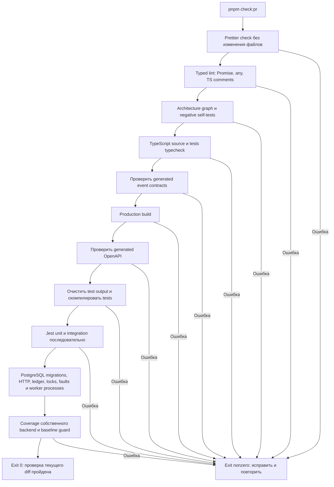

# Проверка функционала перед PR

Перед каждым PR из корня выполнить:

```sh
pnpm check:pr
```

Команда останавливается на первом неуспешном шаге. Ненулевой exit code запрещает
считать проверку завершённой. После изменения поведения нужно повторить запуск
на итоговом diff. Указать команду и результат в описании PR.

## Ревью до итогового прогона

Каждое завершённое изменение интерфейса, бизнес-требований или фичи запускает
обязательное ревью исполнителем без отдельного запроса. Исправления проходят
повторное ревью и проверки функционала. Полный порядок и критерии —
[требования к код-ревью](code-review.md#обязательное-ревью-после-изменения-функционала).
В PR зафиксировать результат этого цикла. `check:pr` проверяет код командами,
но не заменяет смысловую проверку реализации и требований.

## Предусловия и границы

Установить dependencies через `pnpm install --frozen-lockfile`. Нужны Node/pnpm
из package.json и работающий Docker-compatible daemon с доступным socket.
Для typed lint нужен Node ^22.13.0 либо >=24. Для первой загрузки образов нужен доступ к registry. PostgreSQL/Testcontainers
должен запускаться локально. Dev Compose и рабочая .env для этих тестов не нужны.
Миграции применяются к отдельным disposable БД. Рабочие volume не очищаются.

Если Docker недоступен, integration падает. Skip, mock fallback, passWithNoTests и
forceExit не включены. Без успешного integration прогона проверка PR не пройдена.
Не запускать два test:prepare/check:pr одновременно в одном checkout.

Это локальная команда и обязательное правило review. Автоматического запуска при
создании PR, Git hook или обязательного CI status check пока нет. Эта задача не
настраивает внешний хостинг и не публикует проект. Команду можно использовать
будущим CI без изменения состава проверок.

## Что выполняется



Root check:pr сначала проверяет lint/архитектуру/self-tests, затем вызывает backend
test:pr → test:coverage: test:prepare один раз, Jest с jest.coverage.config.cjs
и --runInBand, затем проверка coverage baseline. Подготовка не дублируется двумя параллельными
командами. Последовательное исполнение уменьшает конкуренцию ресурсов тестового
стенда; явные конкурентные тесты внутри suites продолжают создавать реальные гонки.
Build/test output может перезаписываться; source/generated contracts не регенерируются
автоматически ради зелёного результата. Ошибку generation diff нужно исправить
штатным generator и проверить полученный diff.

## Быстрый функциональный прогон

```sh
pnpm test:functional
```

Это все integration suites, а не только последний изменённый модуль. Они используют
реальные PostgreSQL migrations, Nest HTTP/Supertest, worker/CLI child processes,
DB locks и SQL fault injection. Unit-тесты в эту команду не входят. Она удобна во
время разработки, но не заменяет итоговый check:pr.

При изменении Dockerfile/Compose дополнительно выполнить docker:image-check и docker:gate.
Они не входят в обычный PR-прогон, так как проверяют упаковку, сборку image и отдельный
сквозной стенд. test:db-baseline перезапускает dev Compose и тоже не включён в check:pr.

## Как понимать результат

Зелёный прогон доказывает прохождение написанных сценариев в проверенном окружении.
Он не доказывает 100% покрытия ветвей, всех interleavings, реальных физических действий
оператора или внешнего deployment. Число tests не равно числу бизнес-требований.
Границы конкретного diff указывать через traceability таблицу, например
[WMS-206](reports/wms-206.md#соответствие-diff-документации-и-тестов).

Новых бизнес-сценариев нельзя считать проверенными только потому, что старые tests
прошли. Для изменения добавить проверки его наблюдаемых результатов, отказов,
конкуренции и rollback. Внешние/ручные проверки и неисполненные команды отметить отдельно.

[Политика качества и покрытия](quality.md). HTML/JSON coverage — apps/backend/coverage/backend.
Новые или пропавшие source записи и снижение метрик блокируют baseline guard.
