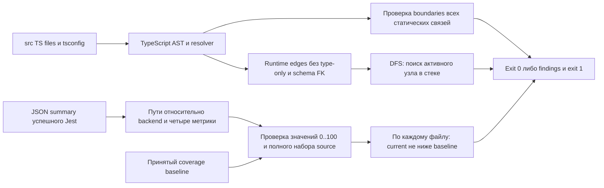
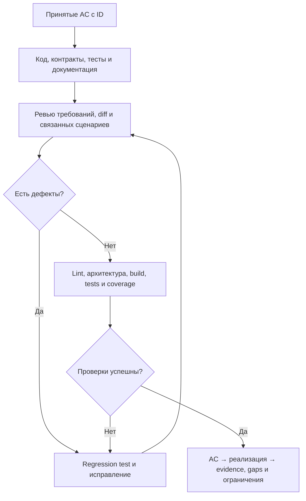

# Качество изменения: требования, читаемость и доказательства

Владелец правил готовности и покрытия. AGENTS.md ссылается сюда; детали ревью —
в [code-review](code-review.md), запуск — в [pr-checks](pr-checks.md).

## Требования до реализации

Исполнитель заполняет [шаблон изменения](templates/change.md). Вход, участник,
доверие, права, результат, ошибки и инварианты определяются до зависимого кода.
Неясное бизнес-решение согласует владелец продукта. Технические детали исполнитель
выбирает в согласованном объёме. Критерии AC имеют стабильные ID и проверяемые результаты.

В отчёте каждый AC связан с методом реализации, файлом/названием теста и фактическим
результатом. Это проверка требований, не количество тестов. Изменение AC требует
сверки существующих tests/contracts; нельзя автоматически менять ожидания теста
под новую реализацию без принятого изменения смысла. Исторические этапы не объявляются
задним числом полностью трассированными: матрицы добавляются при их изменении.

## Читаемость и простота

Функция имеет одну понятную ответственность. HTTP parsing, бизнес-решение и SQL
не смешиваются. Длинное имя допустимо, если объясняет действие. Набор флагов для
независимых бизнес-операций — повод разделить методы. Лимит строк функции сам по себе
не доказывает качество. Абстракция решает реальную повторяющуюся задачу; shared
не становится владельцем бизнес-правила. [DRY](shared.md).

Strict TypeScript сохраняется. Explicit any и ts-ignore/ts-nocheck запрещены.
Внешний input имеет тип unknown с runtime narrowing. Cast не заменяет проверку,
особенно для DB/raw JSON. ts-expect-error допускается только с содержательной причиной;
lint-disable требует конкретного обоснования при ревью. Unused disables — ошибка.
Promise await/return/catch обязательны; void сам по себе не обрабатывает rejection.

## Автоматические проверки

| Команда                 | Что реально проверяется                                                                                                      |
| ----------------------- | ---------------------------------------------------------------------------------------------------------------------------- |
| pnpm lint               | Typed ESLint source/tests: explicit any, floating/misused Promises, TS suppressions                                          |
| pnpm check:architecture | Статические source imports/exports/литеральные require/import: shared boundaries, чужие private repositories, runtime cycles |
| pnpm test:quality       | Отрицательные self-tests guards и настоящих lint rules                                                                       |
| pnpm test:coverage      | Все Jest suites с Docker, build/generation; покрытие всех собственных dist JS файлов                                         |
| pnpm check:pr           | Полная цепочка выше, format/typecheck/contracts/OpenAPI и tests/coverage                                                     |

ESLint 10.14.0 и typescript-eslint 8.72.1 закреплены в lockfile. Typed parser использует
оба tsconfig, включая tests. Node: ^22.13.0 либо >=24; Docker runtime Node 24 совместим.
Настройка по [ESLint flat config](https://eslint.org/docs/latest/use/configure/configuration-files)
и [typed linting](https://typescript-eslint.io/getting-started/typed-linting/).

Architecture guard не исполняет код и не анализирует произвольную вычисляемую загрузку.
Schema FK callbacks создают допустимые взаимные ссылки, поэтому *.schema.ts и агрегатор
schema.ts исключены только из runtime cycle graph. Их boundaries продолжают проверяться;
DDL проверяют реальные migrations. Dynamic/computed imports требуют ручного ревью.
Это не полное доказательство отсутствия всех runtime циклов. Межмодульная SQL запись
и качество декомпозиции по-прежнему проверяются ревью и интеграционными тестами.

## Как исполняются guards

Пример запрещённой связи: `shared/a.ts → modules/inventory/services/inventory.service.ts`.
Architecture guard возвращает `shared boundary: ...` и exit 1. Локальный импорт своего
repository разрешён; чужого — finding даже для type-only связи. Type-only edges не
участвуют в runtime DFS. Проверка читает только source/config, не подключается к БД.

Coverage guard читает coverage-summary.json и baseline, нормализует абсолютные пути,
сравнивает lines/statements/functions/branches. Пример: baseline branches=90, current=89
даёт отказ; отсутствие метрики тоже отказ, а не успешное сравнение с undefined.
Guard не меняет baseline или HTML. Test fixtures создаются/удаляются в temp directories,
не в production source; cleanup выполняется в finally.

## Политика покрытия

1. Цель — evidence для 100% принятых AC, включая ошибки и запрещённые эффекты.
2. Для критических бизнес-правил цель — 100% branch coverage вместе с SQL/integration
   проверками. Число строк и coverage не доказывают все interleavings.
3. Jest измеряет все собственные backend файлы через collectCoverageFrom, в том числе
   неисполненные. Исключён только generated output; source схемы/DTO/entrypoints остаются.
4. Порог IdentityController 100% statements/branches/functions/lines сохранён.
   Остальные gaps публикуются по файлам. Нельзя утверждать, что всем модулям уже
   установлен или достигнут порог 100%. Повышение gates опирается на фактический baseline.
5. Coverage guard сравнивает каждый файл с docs/coverage-baseline.json. Снижение любой
   метрики, пропавший или новый source без принятого baseline дают отказ. Baseline создаётся
   только после успешного полного прогона и не перезаписывается автоматически.
6. Нельзя уменьшать охват файлов/порог, скрывать uncovered или отключать integration
   ради зелёного отчёта. Изменение baseline/исключения требует причины и ревью.
7. HTML и JSON summary: apps/backend/coverage/backend, Git ignored. Каждый отчёт
   указывает область/provider/ветви и пробелы. Child-process CLI coverage не объединяется
   с родительским Jest: CLI могут быть функционально проверены при неполном coverage отчёте.

Всеобщее 100% code coverage не является достигнутым результатом этой задачи. Недостающие
ветви нужно закрывать meaningful tests по риску. Не тестировать декораторы/generated
построчно ради цифры. Проверка качества тестов для критического правила: преднамеренное
удаление защиты должно привести к отказу соответствующего теста. Такой mutation probe
выполняется изолированно, изменение обязательно отменяется; отдельный mutation engine не установлен.

Исходная точка после успешного полного прогона: 196 source файлов, lines 90.45%,
branches 94.35%, functions 90.06%. [Фактические gaps и результаты](reports/quality-baseline.md).
JSON baseline — принятая исходная точка, не команда автоматического обновления при failure.
Для intentional изменения файла reviewer сверяет AC/tests и причину baseline diff;
новое бизнес-правило по-прежнему имеет цель 100% ветвей. Baseline не разрешает оставлять
новый сценарий непроверенным из-за низкого прежнего процента.

## Регрессии и независимость тестов

Каждый поведенческий дефект получает regression test. По возможности зафиксировать
отказ на старом коде до исправления. Тест проверяет контракт, не внутренний порядок
вызовов. Для ошибки проверять отсутствие business/movement/audit/outbox эффектов и
освобождение ресурсов. Mocks уместны для изоляции внешней границы, но не заменяют SQL
locks, migration guards, atomicity или реальные политики доступа.

Тест не зависит от порядка, общих изменяемых данных или случайного sleep. Время и UUID
в сценариях должны иметь контролируемые источники или проверяться по инвариантам, а не
угаданным значениям. Fault injection и barriers документируются. Синтетические fixtures
вызывают владельцев, не копируют reserve/pick/ship расчёты. Сравнивать независимые стороны
учёта: баланс с ledger, task с marker, effects с movements.

Сквозной AC-QUALITY-01 закреплён в shipping.spec.ts: reserve → partial pick → partial ship
→ cancel → return. После каждого commit проверяются reserved=SUM(active), allocation
identity, onHand и consumed. Это постоянный integration test, не новый production сценарий.

## Обязательный процесс

Если новая бизнес-неопределённость мешает исправлению, согласовать её; не замыкать цикл
на придуманном правиле. Одна актуальная версия описания находится у владельца правила.
Правка статуса заменяет устаревшее утверждение, а не добавляет противоположное в конец.
[Отчёт внедрения](reports/quality-baseline.md).
