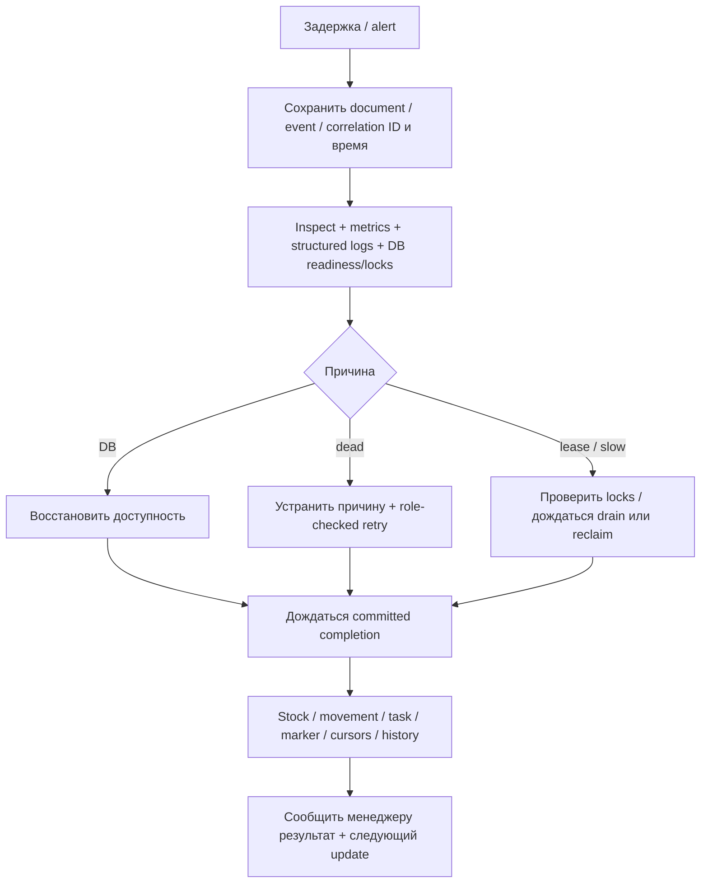

# Репетиция инцидента WMS-404

Вход: оператор с доступом к локальному Docker запускает `pnpm recovery:drill`.
Команда не принимает DSN/URL, не читает рабочую .env для fault injection. Каждый
integration suite создаёт disposable PostgreSQL с реальными migrations. Monitoring
часть использует отдельные UUID Compose projects. Внешние сообщения не отправляются.
На Mac запускать `caffeinate -i pnpm recovery:drill`, без sleep и параллельного coverage.

## Согласованные dev-цели

Пользователь согласовал 2026-11-13: HTTP p95 ≤100 ms при 10 receipts/s;
штатный delivery age ≤30 s; drain 100 events ≤15 s; recovery ≤60 s после устранения
причины. Основание — [baseline WMS-403](../reports/wms-403.md): p95 23.65 ms,
drain 5.69 s. Это начальные цели локального стенда; длительная availability/error-budget
статистика ещё не накоплена. Часы recovery начинаются после восстановления зависимости,
а не включают произвольное время ожидания решения оператора.

Alerts сохранены по согласованию: dead>0 / for5s, oldest>60s / for5s,
processing errors / for5s, scrape unavailable / for15s. Цель age30s и alert60s
различаются намеренно: есть запас для диагностики; отсутствие alert не доказывает SLO.
После faults gate ждёт очистки error window и проверяет 60 s без pending/firing alerts,
при этом API/worker/collector должны иметь up=1. Это короткая проверка, не доказательство
отсутствия шума на протяжении суток. См. [правила alerts](../../infra/observability/alerts.yaml).

## Сценарии и действия оператора

| Случай            | Диагностика                                                                                 | Восстановление                                                                                | Независимая сверка                                                                        |
| ----------------- | ------------------------------------------------------------------------------------------- | --------------------------------------------------------------------------------------------- | ----------------------------------------------------------------------------------------- |
| DB unavailable    | ready=503, live=200, claim отвергнут; проверить доступность БД, не повторять post новым key | Восстановить LOGIN только test role; дождаться SELECT1/ready200; возобновить worker           | Posted receipt/stock10/movement1 сохранены, task/marker1 после обработки                  |
| Dead event        | Inspect/signal, lastError, eventId, stream, attempts, оба cursors, marker                   | Устранить test-only trigger fault, адресный CLI retry с operator/reason и admin DB role       | Та же identity, история/audit сохранены, один task/marker/movement                        |
| Expired lease     | Сопоставить token/lease с активными DB locks; истечение часов не снимает lock               | После crash worker сам reclaim-ит; stale token отвергнут; не выполнять dead retry             | Старый owner не пишет эффект/ack/failure, новый owner пишет один эффект                   |
| Медленный handler | Processing + DB locks, отсутствие committed marker; независимые streams продолжаются        | При живом handler ждать bounded operation; после timeout/crash штатный recovery, не reset SQL | Barrier-тест и child SIGTERM доказывают drain/rollback, отсутствие второго claim и дублей |

Fault hooks есть только в tests. Нельзя переносить SQL mutations lease/trigger из fixture
в пользовательскую БД. Реальное управление dead — [операторский runbook](event-recovery.md).
DB role `warehouse_outbox_admin` проверяется отдельно от системного UUID оператора;
UUID не является аутентификацией человека. Runtime role не получает admin grants.

## Менеджерский статус

Оператор отправляет статус человеку вручную; drill не рассылает сообщения. Шаблон:
«Процесс: создание задания размещения. Приёмка <documentId> подтверждена в <UTC>.
Учётный остаток сохранён; задание ещё не подтверждено. Причина: <DB unavailable /
dead / lease recovery / processing>. Последняя проверка: <UTC>. Следующее обновление:
<UTC не позднее чем через 60 s>. Ответственный: <оператор>.»

При недоступной БД писать: «Сохранность сейчас не удалось перечитать; последнее
подтверждение <UTC>, новых доказательств потери нет». HTTP timeout без сохранённого
ответа — неизвестный результат; проверять исходный key, не обещать commit.
После recovery: «Delivery completed, task pending; физическое размещение ожидается.
Сверка stock/movement/task/marker пройдена; инцидент закрыт в <UTC>».
Не называть completed delivery завершением всего складского процесса.

## Evidence и поиск

`docs/reports/wms-404-evidence.json` генерирует только успешный `recovery:drill`.
Файл содержит UTC запуска/окончания и имена/status/duration тестов без SQL errors,
credentials/payload. Duration теста включает fixture/assertions и не называется MTTR.
DB test отдельно ограничивает восстановление; lease/slow tests используют barriers,
а не вывод о гонке по sleep. Для каждого ручного инцидента записать detectedAt,
causeRemovedAt, verifiedAt, eventId, исходный key, operator/reason и SQL итоги.

Loki: `{service="warehouse-backend"} | json | correlationId="<ID>"`, аналогично
`eventId`, `aggregateId`, `errorCode`. Trace links — [observability flow](../flows/observability.md).
Идентификаторы остаются полями: gate подтверждает ровно четыре Loki labels;
API/worker/CLI записи одного сценария и producer/consumer traces доступны централизованно.

Cleanup выполняют harness/Compose finally, только для собственных UUID resources.
Images/cache остаются. При SIGKILL/потере daemon адресный cleanup выполнять по
[load flow](../flows/load-testing.md); глобальные prune и удаление dev volumes запрещены.
