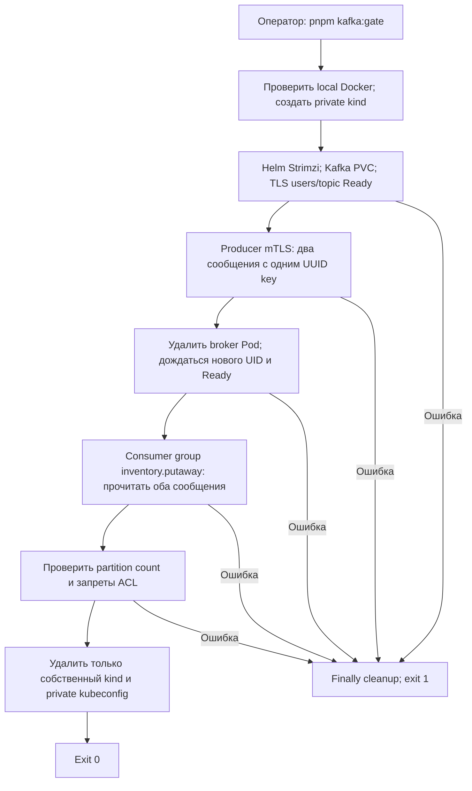

# Dev Kafka: WMS-501

## Для менеджера

Kafka пока не участвует в складской операции. PostgreSQL transactional outbox,
существующий worker и processed markers продолжают работать. Этот стенд проверяет
инфраструктуру будущего транспорта, а не cutover или доставку бизнес-эффектов.
Потеря одного broker временно останавливает транспорт. Это не HA.

## Версии и ресурсы

Закреплены Strimzi 1.3.1, Kafka 4.3.2, kind 0.33.0, Kubernetes 1.37.0,
Helm 3.22.0. [Официальная совместимость](https://strimzi.io/downloads/):
Strimzi 1.3.1 тестируется с Kubernetes 1.32–1.37 и поддерживает Kafka 4.3.2.
Формат CR взят из [versioned example](https://github.com/strimzi/strimzi-kafka-operator/blob/1.3.1/examples/kafka/kafka-single-node.yaml).
Это отдельная platform dependency, не часть infra/helm/warehouse.
Один node Docker делит CPU/RAM с остальными проектами. На проверяемой машине Docker:
11 CPU, 8217890816 bytes RAM. Broker requests 250m/768Mi, limits 2CPU/1536Mi,
heap 384Mi. Дополнительно нужны operator/entity operators и Kubernetes; отсутствие
ресурсов диагностировать через describe pod/events, не уменьшать replication скрыто.

## Установка и проверка

Установить закреплённые tools по [kind flow](../../docs/flows/kind-helm.md).
`pnpm kafka:gate` создаёт собственный случайный cluster и private KUBECONFIG,
устанавливает operator Helm chart 1.3.1, применяет dev.yaml, ждёт Kafka/Topic/User Ready.
Затем создаёт временный CLI Pod с TLS credentials, пишет два сообщения с одним UUID
key, удаляет broker Pod, ждёт новый Pod с другим UID и читает оба сообщения.
Проверяются порядок и одинаковая partition; данные читаются после рестарта с PVC.
Gate также проверяет фактический partition count и broker ACL denials: consumer
не публикует в topic, чужая consumer group не допускается. Remote Docker endpoint
отклоняется до создания cluster.
Это synthetic transport smoke, не schema validation или application handler.
Finally удаляет только собственный cluster; .env и рабочие volumes не используются.
Команда скачивает operator/chart/images, требует Docker socket, сеть, kind/kubectl/Helm.
Переопределение путей tools: WMS_KIND/WMS_KUBECTL/WMS_HELM.



Для длительного dev-стенда: создать отдельный kind cluster из kind flow, затем:

```sh
kind create cluster --name warehouse-kafka --image 'kindest/node:v1.37.0@sha256:a1ed56cfb0e7b93589bdf97c8cd566405a265939e3620fc4f5de89adff580ae5' --wait 180s
kubectl --context kind-warehouse-kafka create namespace warehouse-kafka
helm install strimzi strimzi-kafka-operator --repo https://strimzi.io/charts/ --version 1.3.1 --namespace warehouse-kafka --kube-context kind-warehouse-kafka --wait --timeout 300s
kubectl --context kind-warehouse-kafka -n warehouse-kafka apply -f infra/kafka/dev.yaml
kubectl --context kind-warehouse-kafka -n warehouse-kafka wait kafka/warehouse --for=condition=Ready --timeout=300s
```

Gate — основной воспроизводимый путь с автоматическим cleanup. Ручной пример
предполагает предварительное создание cluster с именем warehouse-kafka.

## Топология и контракты

| Поток                                              | Topic                      | Key                                          | Partitions | RF / min ISR | Consumer group / DB logical name |
| -------------------------------------------------- | -------------------------- | -------------------------------------------- | ---------- | ------------ | -------------------------------- |
| receipt, включая будущие schema/aggregate versions | warehouse.receiving.events | aggregateId UUID в canonical lowercase UTF-8 | 3          | 1 / 1        | inventory.putaway                |

Других бизнес-потоков текущий outbox registry не публикует. Новые потоки требуют
явной записи topology/контракта; нельзя автоматически делать topic из event type
или schemaVersion. EventId остаётся прежним при повторе; key не eventId, warehouseId
или номер версии. Envelope и JSON Schema остаются в Git; Registry — WMS-502.
Publisher WMS-503 обязан фиксировать один partitioner для всех producer versions и
сериализовать aggregate versions. Одинаковый key сам по себе не исправляет перестановку
конкурентных publish. Console tools smoke не заменяет этот application contract.

Retention: delete, 604800000 ms; 268435456 bytes на partition; segment 16777216 bytes.
Удаляется целый segment, поэтому это не точная квота диска и не гарантия семи дней
истории при раннем достижении byte limit. Compaction выключена: промежуточные версии
нужны для cursor. Outbox/БД не очищаются retention Kafka. Consumer offline дольше
retention требует явного replay/start-position плана; нельзя перескочить gap.

### Изменение числа partitions

В dev.yaml число partitions зафиксировано. Не выполнять alter partitions во время
жизни агрегатов: hash(key)%N меняет partition, а порядка между partitions нет.
Остановка producer и drain сами по себе не защищают последующие версии старого UUID.
Процедура нового поколения: остановить запись, backup БД/границы cursors, дождаться
обработки старого потока; оставить старый topic доступным для replay; новое поколение
с новым числом partitions принимает только НОВЫЕ aggregate IDs. Все версии старых
IDs остаются в исходном topic. До этого нужен ADR, routing map и cutover/recovery
runbook WMS-506. Автоматическая смена поколения в WMS-501 не реализуется.
Если требуется продолжать старые IDs в одном topic с новым N, сначала реализовать
и проверить persisted explicit partition mapping; обычный repartition запрещён.

## Доступ и credentials

Внутренний bootstrap warehouse-kafka-bootstrap:9093, только TLS с mTLS.
KafkaUser outbox-publisher: Write/Describe ровно своего topic + IdempotentWrite;
inventory-putaway: Read/Describe topic и Read ровно group inventory.putaway.
Create/Delete/Alter topics и чужие groups не выдаются. Это будущие service identities,
не пользователи склада. User Operator создаёт Secrets с сертификатом/ключом/PKCS12;
CA trust — warehouse-cluster-ca-cert. Не выводить Secret YAML, passwords, private keys
в логи/committed manifests. В gate оба Secret доступны одному test Pod только ради
smoke. Реальные publisher/consumer Pod должны монтировать только свой Secret.
Rotations выполняет Strimzi; приложение должно перечитывать credentials/перезапускаться
по отдельному rollout. Никакой внешний listener или port-forward здесь не нужен.

## Storage, диагностика, очистка

2Gi RWO PVC на local kind storage содержит log и KRaft metadata. deleteClaim=false
сохраняет PVC после удаления Kafka CR. Это не backup и не защита от удаления kind.
Проверять get kafka/kafkanodepool/kafkatopic/kafkauser/pods/pvc; describe Kafka и events;
логи strimzi-cluster-operator и broker. Не публиковать credentials при диагностике.
TLS ошибки: проверить CA, срок cert, имя сервиса; authorization errors: topic/group ACL;
Pending PVC/Pod: provisioner, node RAM/disk, requests/limits и image pull.

Для удаления долгоживущего dev стенда: остановить клиентов; сохранить нужный backup;
удалить Kafka CR; убедиться, что PVC остался; отдельно удалить PVC только после явного
решения владельца данных. Helm uninstall operator не является удалением Kafka данных.
Удаление kind cluster — окончательное удаление его local volumes, включая retained PVC.
В disposable gate это разрешено самим сценарием; общие docker prune не используются.

[AC, результаты и ограничения](../../docs/reports/wms-501.md).
